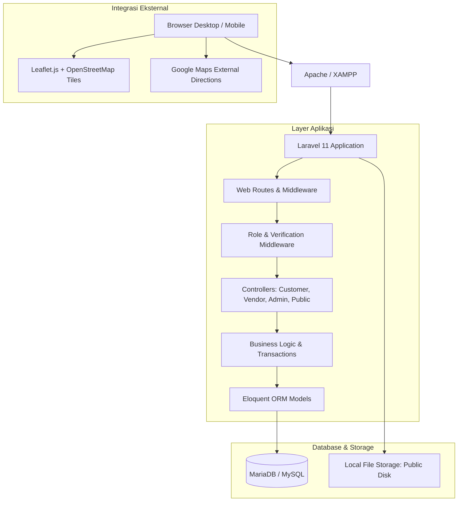
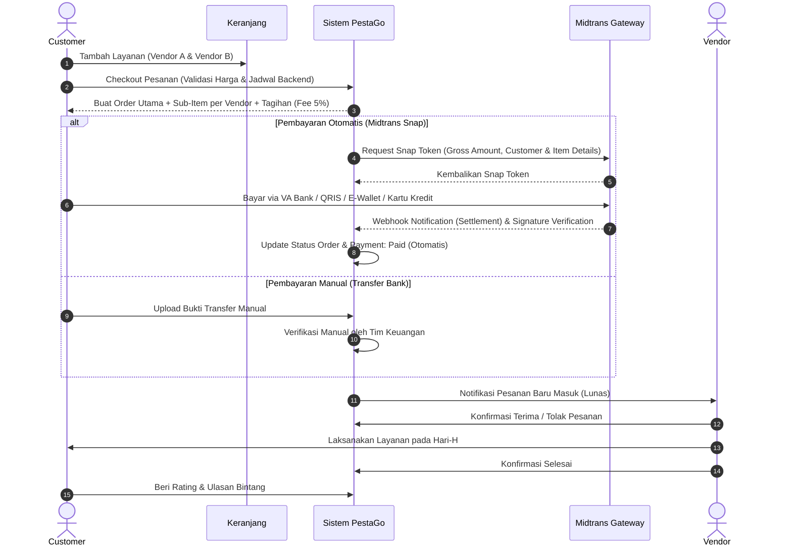

# 🏛️ Arsitektur Sistem PestaGo

## 1. Ikhtisar Arsitektur

PestaGo dibangun dengan arsitektur **Monolith Modern** berbasis framework **Laravel 11+ / PHP 8.2+** yang menyatukan alur bisnis multi-vendor, katalog layanan, sistem lokasi pemetaan OpenStreetMap / Leaflet.js, serta panel manajemen untuk Customer, Vendor, dan Super Admin dalam satu ekosistem yang terintegrasi.

---

## 2. Struktur Peran & Hak Akses (Role-Based Access Control)

Sistem menggunakan 3 peran utama dengan middleware penjagaan ketat:

1. **Customer (`role: customer`)**:
   - Membuka katalog publik dan melihat detail vendor.
   - Membuat rencana acara (`Event Planning`) dengan estimasi budget & lokasi.
   - Keranjang multi-vendor: memilih beberapa vendor dalam 1 kali checkout.
   - Melakukan checkout, upload bukti transfer, dan memantau status pesanan.
   - Mengajukan pembatalan item pesanan sesuai ketentuan.
   - Memberikan rating & ulasan bintang (1-5) setelah layanan selesai.
   - Berkirim pesan chat langsung dengan vendor.

2. **Vendor (`role: vendor`)**:
   - **Quick Register**: Form pendaftaran awal ringkas (Nama, No WA/Telepon, Email, Password, Nama Brand, Kategori).
   - **Onboarding & Verification Stepper**:
     1. Status `incomplete`: Akun aktif masuk dashboard, fitur pembuatan katalog dan pesanan terkunci.
     2. Pengisian Persyaratan: Data workshop/kantor lengkap, deskripsi usaha, rekening bank pencairan dana, serta unggah dokumen legalitas (Foto KTP Pemilik, SIUP/NIB/SKU, dan Portofolio).
     3. Status `pending`: Berkas masuk antrean peninjauan Super Admin.
     4. Status `needs_revision`: Jika ada kekurangan (misal KTP buram), vendor menerima catatan perbaikan dan dapat mengunggah ulang berkas tanpa daftar dari nol.
     5. Status `rejected`: Ditolak jika usaha fiktif/melanggar kebijakan, disertai kontak bantuan dukungan admin.
     6. Status `active`: Disetujui admin, seluruh fitur terbuka penuh.
   - CRUD Layanan: upload galeri foto, fasilitas, kapasitas, harga, alamat, serta titik pin peta (latitude & longitude).
   - Kalender Booking & Ketersediaan: memantau pesanan masuk dan memblokir tanggal libur/pesanan offline untuk mencegah *double booking*.
   - Manajemen Pesanan: menerima pesanan atau menolak dengan mencantumkan alasan.
   - Membalas ulasan dari pelanggan.
   - Memantau saldo, omzet, dan riwayat pendapatan.
   - Mengajukan poster promosi/iklan berbayar.

3. **Super Admin (`role: super_admin`)**:
   - Dashboard statistik komprehensif (pengguna, vendor, pesanan, perputaran uang, komisi platform).
   - Verifikasi vendor baru (Approve / Tolak / Minta Perbaikan).
   - Manajemen user (aktifkan/nonaktifkan akun).
   - CRUD Kategori layanan.
   - Pengawasan seluruh pesanan multi-vendor.
   - Verifikasi bukti transfer pembayaran manual.
   - Proses klaim refund pelanggan jika pesanan dibatalkan/ditolak.
   - Moderasi iklan dan promo vendor.
   - Laporan tren pendapatan bulanan, top vendor, dan performa kategori.

---

## 3. Alur Transaksi Multi-Vendor

---

## 4. Sistem Lokasi & Pemetaan

1. **Leaflet.js + OpenStreetMap**:
   - Gratis tanpa memerlukan Google Maps API Key untuk dev lokal.
   - Terintegrasi di halaman detail layanan (`services.show`) dengan pin lokasi akurat dari latitude dan longitude yang tersimpan di database.
   - Map picker interaktif untuk vendor saat menambah atau mengedit layanan.
   - Map picker saat customer membuat atau mengedit acara.

2. **Petunjuk Arah Eksternal**:
   - Tombol **Petunjuk Arah** otomatis menyusun tautan navigasi langsung ke Google Maps (`https://www.google.com/maps/dir/?api=1&destination=LAT,LNG`).
   - Tombol **Buka di Google Maps** untuk melihat lokasi sekitar.

---

## 5. Keamanan & Integritas Data

- **Password Hashing**: Menggunakan algoritma Bcrypt bawaan Laravel (work factor 12).
- **Proteksi CSRF**: Token verifikasi di setiap formulir web.
- **Proteksi Akses Data**: Vendor hanya dapat mengelola data dan layanan miliknya (`$item->vendor_profile_id === $vendor->id`).
- **Validasi Harga di Backend**: Harga total dihitung ulang langsung dari snapshot database saat checkout; tidak mengandalkan kalkulasi sisi browser.
- **Snapshot Data**: Nama layanan, harga satuan, dan tipe paket disimpan sebagai snapshot pada tabel `order_items` sehingga riwayat transaksi tetap abadi walaupun vendor mengubah harga katalog di kemudian hari.

---

## 6. Manajemen Staf & Role-Based Access Control (RBAC)

Sistem membedakan antara **Super Administrator** dan **Staff Admin**:
1. **Super Administrator**:
   - Memiliki kendali penuh ke seluruh sistem, termasuk membuat, mengedit, atau menonaktifkan akun staf lain.
2. **Staff Admin**:
   - Dibuat oleh Super Admin dengan titel jabatan kustom (misal: *Customer Care*, *Verifikator Vendor*, *Finance*, *Marketing*).
   - Memiliki preset izin instan (1-klik) atau izin granular berbasis JSON permissions:
     - `vendors_view`, `vendors_manage` (Kurasi & Verifikasi Vendor)
     - `chats_view`, `chats_reply` (Live Chat Support)
     - `orders_view`, `orders_manage` (Manajemen & Konfirmasi Pesanan)
     - `payments_view`, `payments_manage` (Validasi Pembayaran & Rekening)
     - `services_view`, `services_manage` (Moderasi Katalog Layanan)
     - `ads_view`, `ads_manage` (Moderasi Iklan & Promosi)
     - `staff_manage` (Kelola Tim Internal)
   - Menu sidebar admin beradaptasi dinamis sesuai hak akses yang dimiliki oleh staf.

---

## 7. Layanan Bantuan Langsung (Live Chat Customer Care)

- **Akses Fleksibel**: Customer dan Vendor dapat menghubungi tim PestaGo secara real-time melalui tombol *Chat Customer Care*.
- **Transparansi & Humanis**: Teks antarmuka verifikasi tidak lagi menyebut "Admin" melainkan *"Tim Kurasi PestaGo"* atau *"Customer Care PestaGo"*.
- **Pusat Bantuan Staf**: Seluruh tiket percakapan bantuan masuk ke `/admin/chats` dengan filter status, pencarian instan, dan penugasan penanganan staf.

---

## 8. Integrasi Midtrans Payment Gateway & Pengelolaan Opsi Iklan Vendor

1. **Midtrans Snap Multi-Channel**:
   - Diterapkan pada transaksi pesanan customer (`Order`) dan pengajuan promosi poster vendor (`Advertisement`).
   - Mendukung pembayaran instan melalui Virtual Account Bank (BCA, Mandiri, BNI, BRI, Permata), QRIS (GoPay, ShopeePay, OVO, Dana), Kartu Kredit, dan Gerai Retail.
   - Menggunakan webhook signature SHA-512 verification untuk keamanan validasi callback tanpa risiko pemalsuan status.

2. **Pengelolaan Opsi & Tarif Iklan (`AdvertisementPlan`)**:
   - Admin dan staf (dengan hak akses iklan) dapat menambah, mengedit, mengaktifkan/menonaktifkan posisi papan iklan di `/admin/ad-plans`.
   - Mengatur tarif dan durasi secara dinamis untuk tier *Basic*, *Pro*, dan *Business*.
   - Mengatur teks badge promosi (*POPULER*, *STANDOUT*), deskripsi penempatan, dan panduan resolusi kanvas poster.
   - Form pengajuan iklan vendor (`vendor/advertisements/create`) membaca opsi dan tarif langsung dari database secara real-time.

3. **Siklus Perbaikan & Kirim Ulang Revisi Iklan**:
   - Jika iklan berstatus `needs_revision` atau `rejected` oleh Tim Kurasi, vendor dapat langsung mengklik tombol **Perbaiki Iklan** di tabel riwayat.
   - Vendor melihat catatan revisi kurator secara transparan dan dapat mengunggah poster revisi baru atau mengubah judul/tautan aksi.
   - Karena slot iklan telah dibayar lunas (`payment_status = paid`), vendor **tidak dikenakan biaya lagi** saat mengirimkan perbaikan (`PUT /vendor/advertisements/{advertisement}`).
   - Sistem mengembalikan status review ke `pending_review` dan mengirimkan notifikasi otomatis ke tim kurasi untuk diperiksa kembali.

