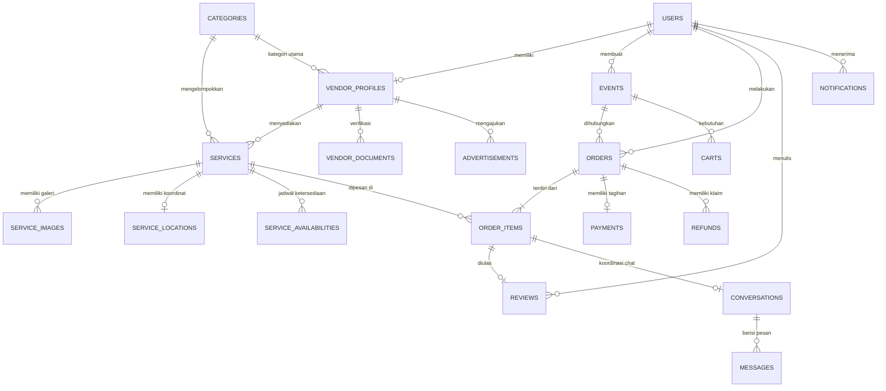

# 🗄️ Struktur Database PestaGo

Database PestaGo dirancang menggunakan **MySQL / MariaDB** dengan relasi antar-tabel yang ternormalisasi untuk menjamin integritas data transaksi multi-vendor.

---

## 1. Diagram Relasi Entitas (ERD)

---

## 2. Rincian Tabel Utama

### 1. `users`
Tabel pengguna tunggal untuk semua peran.
- `id` (BIGINT, PK, AI)
- `name` (VARCHAR)
- `email` (VARCHAR, UNIQUE)
- `password` (VARCHAR, hash)
- `role` (ENUM: `customer`, `vendor`, `super_admin`)
- `phone` (VARCHAR)
- `avatar` (VARCHAR, nullable)
- `is_active` (BOOLEAN, default: true)
- `created_at`, `updated_at` (TIMESTAMP)

### 2. `vendor_profiles`
Profil bisnis dan informasi legalitas vendor.
- `id` (BIGINT, PK, AI)
- `user_id` (BIGINT, FK -> users.id)
- `category_id` (BIGINT, FK -> categories.id)
- `business_name` (VARCHAR)
- `slug` (VARCHAR, UNIQUE)
- `description` (TEXT)
- `address`, `city`, `province` (VARCHAR)
- `status` (ENUM: `pending`, `active`, `rejected`, `needs_revision`, `suspended`)
- `rating_avg` (DECIMAL 3,2)
- `rating_count` (INT)
- `rejection_reason` (TEXT, nullable)
- `created_at`, `updated_at` (TIMESTAMP)

### 3. `categories`
Kategori layanan acara (Gedung/Venue, Catering, Dekorasi & MUA, Busana, Dokumentasi, Hiburan, Lainnya).
- `id` (BIGINT, PK, AI)
- `name` (VARCHAR)
- `slug` (VARCHAR, UNIQUE)
- `description` (TEXT, nullable)
- `icon` (VARCHAR)
- `image` (VARCHAR, nullable)
- `is_active` (BOOLEAN)
- `sort_order` (INT)

### 4. `services`
Katalog layanan yang ditawarkan oleh vendor.
- `id` (BIGINT, PK, AI)
- `vendor_profile_id` (BIGINT, FK -> vendor_profiles.id)
- `category_id` (BIGINT, FK -> categories.id)
- `name` (VARCHAR)
- `slug` (VARCHAR, UNIQUE)
- `description` (TEXT)
- `price` (DECIMAL 15,2)
- `price_unit` (VARCHAR: `per_acara`, `per_orang`, `per_hari`, `per_paket`, dll)
- `capacity_min`, `capacity_max` (INT, nullable)
- `facilities` (JSON, nullable)
- `cancellation_policy` (TEXT, nullable)
- `status` (ENUM: `draft`, `published`, `suspended`)
- `is_featured` (BOOLEAN)
- `rating_avg` (DECIMAL 3,2)
- `rating_count` (INT)

### 5. `service_locations`
Titik pemetaan dan alamat fisik layanan.
- `id` (BIGINT, PK, AI)
- `service_id` (BIGINT, FK -> services.id)
- `address` (TEXT)
- `city`, `district`, `province` (VARCHAR)
- `latitude` (DECIMAL 10,8)
- `longitude` (DECIMAL 11,8)
- `location_type` (ENUM: `fixed`, `mobile`, `area`)

### 6. `service_availabilities`
Jadwal ketersediaan untuk mencegah *double booking*.
- `id` (BIGINT, PK, AI)
- `service_id` (BIGINT, FK -> services.id)
- `date` (DATE)
- `status` (ENUM: `available`, `booked`, `blocked`, `pending`)
- `notes` (TEXT, nullable)
- UNIQUE (`service_id`, `date`)

### 7. `events`
Rencana acara yang dibuat customer.
- `id` (BIGINT, PK, AI)
- `user_id` (BIGINT, FK -> users.id)
- `name` (VARCHAR)
- `event_type` (VARCHAR)
- `event_date` (DATE)
- `event_time` (TIME, nullable)
- `location_address`, `location_city` (VARCHAR)
- `location_latitude`, `location_longitude` (DECIMAL)
- `guest_count` (INT, nullable)
- `budget` (DECIMAL 15,2, nullable)
- `requirements` (JSON, kategori id kebutuhan)
- `status` (ENUM: `planning`, `booked`, `completed`, `cancelled`)

### 8. `orders` & `order_items`
Transaksi multi-vendor dan rincian per vendor.
- `orders`: `id`, `user_id`, `event_id`, `order_number`, `subtotal`, `platform_fee`, `total_amount`, `status` (`pending_payment`, `payment_processing`, `paid`, `confirmed`, `completed`, `cancelled`)
- `order_items`: `id`, `order_id`, `vendor_profile_id`, `service_id`, `service_name_snapshot`, `price_snapshot`, `quantity`, `subtotal`, `booking_date`, `status` (`pending_confirmation`, `confirmed`, `rejected`, `in_progress`, `completed`, `cancelled`)

### 9. `payments` & `refunds`
Aliran pembayaran manual / transfer dan pengembalian dana.
- `payments`: `id`, `order_id`, `amount`, `platform_commission`, `payment_method`, `status` (`pending`, `processing`, `paid`, `failed`), `gateway_response` (JSON bukti transfer)
- `refunds`: `id`, `order_id`, `order_item_id`, `refund_number`, `amount`, `reason`, `status` (`pending`, `approved`, `rejected`), `admin_notes`

### 10. `reviews`
Ulasan dan penilaian bintang (1-5) dari customer per item pesanan selesai.
- `id`, `order_item_id`, `user_id`, `service_id`, `vendor_profile_id`, `rating`, `comment`, `vendor_reply`, `vendor_replied_at`
- UNIQUE (`order_item_id`, `user_id`)

### 11. `conversations` & `messages`
Sistem perpesanan customer dan vendor secara real-time.
- `conversations`: `id`, `customer_id`, `vendor_profile_id`, `order_item_id`, `last_message_at`
- `messages`: `id`, `conversation_id`, `sender_id`, `message`, `attachment`, `is_read`

### 12. `advertisements` & `promos`
Promosi landing page dan iklan bersponsor vendor.
- `advertisements`: `id`, `vendor_profile_id`, `title`, `poster_image`, `placement`, `package`, `payment_amount`, `review_status` (`pending_review`, `approved`, `needs_revision`, `rejected`), `starts_at`, `ends_at`
